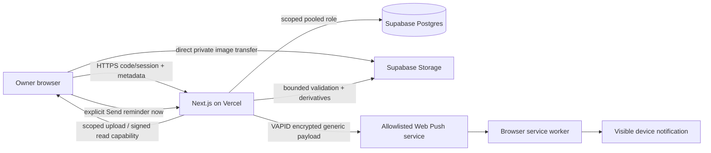

# Hall of Achievements — architecture design

Date: 2026-10-22. Status: proposed architecture supporting the [PRD](../../PRD.md).

## Decision

Start with one Next.js TypeScript application on Vercel and Supabase Postgres/private Storage. Custom owner-code sessions protect every application boundary. Use a scoped pooled database role; isolate privileged Storage credentials. No scheduler, realtime service, separate auth provider, or second backend for the manual-reminder MVP.

The PRD is authoritative for limits, security requirements and acceptance IDs. Reviews retain alternatives and risks; suggestions do not override the final PRD.

## Boundaries

- Authentication: env code, durable abuse limits, opaque sessions, HMAC auth version checked against shared AuthState, expiry/revocation and CSRF/origin checks. Rotation atomically activates the new version/revokes old session rows so stale instances fail closed, including old-code login and mutations. Drain/remove old deployments and protect historical preview URLs before declaring rotation complete; verify in-flight behavior and retain the documented bearer/push residual windows.
- Achievements: validated metadata, pagination/search, pending/ready/deleting transitions and idempotency.
- Assets: quota reservation, random quarantine paths, direct-upload capabilities, bounded decode/derivatives, private reads, cleanup/export.
- Notifications: subscription validation/ownership, encrypted storage, durable attempt claims/cooldown, manual sends and result handling.
- Operations: migrations, consistent export/restore, quotas, redacted errors and credential rotation.

Small repository/asset/sender interfaces allow migration later. A future local deployment replaces Postgres with SQLite and storage with local files and runs the entire app behind a named tunnel; it is not a Vercel filesystem persistence strategy.

## Critical sequences

1. Login: apply durable limits; verify code; issue a fresh random token; persist token hash/auth version; set HTTPS cookie.
2. Upload: reserve full byte budget; issue a random non-overwritable quarantine capability; upload directly; finalize validates bytes and bounded decode; derive display assets; mark ready. Track capability lifetime before releasing failed-path reservations.
3. View: authorize ready metadata/assets; return private data and <=60-second signed reads; no shared/private offline cache. Previously issued capabilities have a residual validity window.
4. Reminder: button posts idempotency ID and explicit own targets; revalidate active sessions; durably claim per-target attempts/cooldown; send generic short-TTL payload; persist accepted/rejected/unknown. No automatic uncertain retries.
5. Revoke/delete: revoke authorization first; tombstone before object deletion; retry cleanup independently. In-flight accepted pushes cannot be recalled.

## Proof and handoff

Before release prove AC1–AC12 against actual provider/browser behavior, including cross-instance limits, private uploads, persistence after redeploy, real-device push and restoration. A build alone cannot establish these behaviors.

This checkpoint is documentation only. Owner decisions are explicit in the PRD; follow the applicable Superpowers planning/design handoffs before product implementation.
